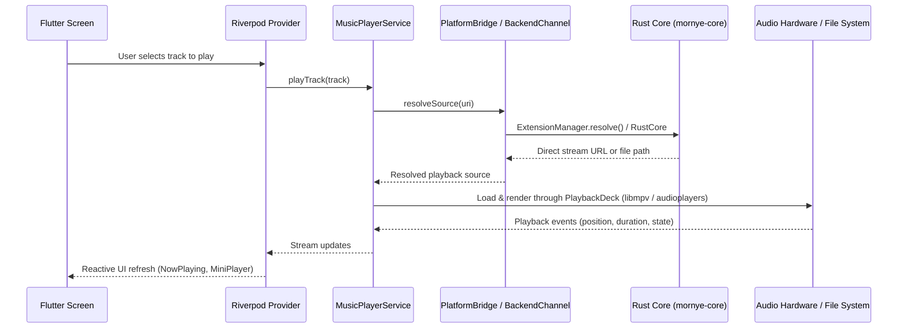

# Architecture

**Analysis Date:** 2026-10-30

## Pattern Overview

**Overall:** Hybrid Layered Architecture with Reactive Riverpod State and Unidirectional Cross-Language IPC/FFI.

**Key Characteristics:**
- **Strict Directional Boundaries:** Clean hierarchy from Presentation → State Controllers → Domain Services → Platform Bridge → Native / Rust Core.
- **Dual Backend Transport:** MethodChannel IPC on mobile platforms (Android/iOS) vs. zero-overhead C-ABI Dart FFI on desktop platforms (Windows/Linux/macOS).
- **Extension-Driven Isolation:** All third-party catalog and metadata sources are executed inside a sandboxed JavaScript runtime (`rquickjs`), preventing malicious code from accessing native APIs directly.
- **Hardware-Direct Audio Pipelines:** Audio playback adapts to platform capabilities—USB Bit-Perfect PCM and Direct DSD on Android, libmpv on desktop, and native AudioSession on Apple devices.

## Layers

**Presentation Layer (UI):**
- Purpose: Renders reactive screens, slivers, bottom sheets, and widgets with dynamic Material 3 Expressive theming.
- Location: `lib/screens/`, `lib/widgets/`, `lib/theme/`
- Contains: Route widgets, custom slivers, mini-player bar, now-playing screen, waveform views, equalizer controls.
- Depends on: Controllers, Providers, Models, Theme, Utils.
- Used by: Flutter Engine.

**State & Controller Layer:**
- Purpose: Manages observable state, UI interaction mixins, batch actions, and background subscriptions.
- Location: `lib/providers/`, `lib/controllers/`
- Contains: Riverpod Notifiers (`PlaybackNotifier`, `DownloadQueueNotifier`, `LocalLibraryNotifier`, `TrackNotifier`, `SettingsNotifier`).
- Depends on: Services, Models, Constants, Utils.
- Used by: Presentation Layer.

**Service & Domain Layer:**
- Purpose: Encapsulates database operations, media player runtime, background notifications, and audio analysis.
- Location: `lib/services/`, `lib/models/`, `lib/utils/`
- Contains: SQLite databases, `MusicPlayerService`, `AutoMixService`, `FFmpegService`, metadata models.
- Depends on: Platform Bridge, SQLite, FFI bindings, System plugins.
- Used by: Providers and Controllers.

**Platform Abstraction & IPC Layer:**
- Purpose: Normalizes operating system differences and channels communication to native code and Rust.
- Location: `lib/services/platform_bridge.dart`, `lib/services/backend/`
- Contains: `BackendChannel`, `RustFfiBackend`, `MethodChannelBackend`, `BridgeSaf`, `BridgeCodec`.
- Depends on: Native OS platforms and compiled Rust libraries.
- Used by: Services and Providers.

**Native Host Layer:**
- Purpose: Platform-specific OS integration for foreground workers, widgets, notifications, and audio permissions.
- Location: `android/app/src/main/kotlin/com/zarz/mornye/`, `ios/Runner/`, `windows/runner/`
- Contains: Android `DownloadService`, `UsbBitPerfectPlugin`, `MainActivity` dispatchers; iOS `AppDelegate.swift`, `CoreBackend.swift`.
- Depends on: Operating System APIs and UniFFI generated bindings.
- Used by: Platform Abstraction Layer.

**Rust Core Backend:**
- Purpose: High-speed, memory-safe computational engine for audio tagging, hashing, network HTTP/2 transport, and extension scripting.
- Location: `rust_backend/crates/` (`core`, `network`, `providers`, `extensions`, `mobile`, `desktop`, `bindgen`)
- Contains: QuickJS sandbox, UniFFI exports, audio analysis, tag readers/writers.
- Depends on: Zero external system dependencies (pure Rust + bundled SQLite/QuickJS).
- Used by: Native Host Layer and Desktop FFI.

## Data Flow

**State Management:**
- Application state is fully managed by **Riverpod** using compile-safe `Notifier` and `AsyncNotifier` patterns.
- Persistent state (settings, playback queue, library index) is automatically persisted to disk via SQLite or `SharedPreferences` on state transitions.

## Key Abstractions

**`PlaybackDeck`:**
- Purpose: Uniform audio engine interface across different operating systems.
- Implementation: `lib/services/playback_deck.dart`, `lib/services/media_kit_playback_deck.dart` (Windows/Linux), `lib/services/music_playback_deck.dart` (Android/iOS).
- Pattern: Adapter / Strategy Pattern.

**`BackendChannel`:**
- Purpose: Transport abstraction dispatching backend method invocations.
- Implementation: `lib/services/backend/backend_channel.dart` (`RustFfiBackend` on desktop, `MethodChannelBackend` on mobile).
- Pattern: Bridge Pattern.

**`ExtensionRuntime`:**
- Purpose: JavaScript sandbox evaluating community catalog providers with bounded memory and execution time.
- Implementation: `rust_backend/crates/extensions/src/runtime.rs`
- Pattern: Sandbox / Facade Pattern.

## Entry Points

**Flutter Application:**
- Location: `lib/main.dart`
- Triggers: OS application launch
- Responsibilities: Initializes bindings, bootstraps SQLite databases, loads persisted settings, sets up Riverpod `ProviderScope`, and runs `MornyeApp`.

**Desktop Rust C-ABI:**
- Location: `rust_backend/crates/desktop/src/lib.rs`
- Triggers: Loaded by `dart:ffi` during desktop startup
- Responsibilities: Initializes directory watchers, embedded SQLite connection, and registers C function pointers (`mornye_init`, `mornye_call`).

**Android Native Entry:**
- Location: `android/app/src/main/kotlin/com/zarz/mornye/MainActivity.kt`
- Triggers: Android intent or app icon launch
- Responsibilities: Registers Flutter plugins, binds backend MethodChannel (`com.zarz.mornye/backend`), configures USB audio intent filters.

**iOS Native Entry:**
- Location: `ios/Runner/AppDelegate.swift`
- Triggers: iOS application delegate lifecycle
- Responsibilities: Configures background tasks, registers audio session category, forwards method calls to `CoreBackend.swift`.

## Error Handling

**Strategy:** Fail-safe defensive design. Network failures, broken extensions, or invalid audio formats never crash the application; errors are caught at module boundaries and surfaced as user-facing notifications or retryable queue states.

**Patterns:**
- Result types and custom exceptions: `ExtensionError`, `PlatformException`, `UsbOutputUnavailable`.
- Safe fallbacks: If an extension download fails, the queue automatically cascades down the prioritized provider list until a working stream is resolved.
- Large JSON chunking / disk spooling: Payload responses exceeding 256 KiB are spooled to temporary files to avoid Android IPC TransactionTooLargeException.

## Cross-Cutting Concerns

**Logging:** Centralized `AppLogger` (`lib/utils/logger.dart`) with categorized log tags (`Playback`, `DownloadQueue`, `PlatformBridge`, `ExtensionManager`).
**Validation:** Model validation via `json_serializable` and strict schema migrations in SQLite (`_runMigrations`).
**Security:** Sandboxed JavaScript execution denying direct file system access unless explicitly brokered by Rust host APIs.

---

*Architecture analysis: 2026-10-30*

